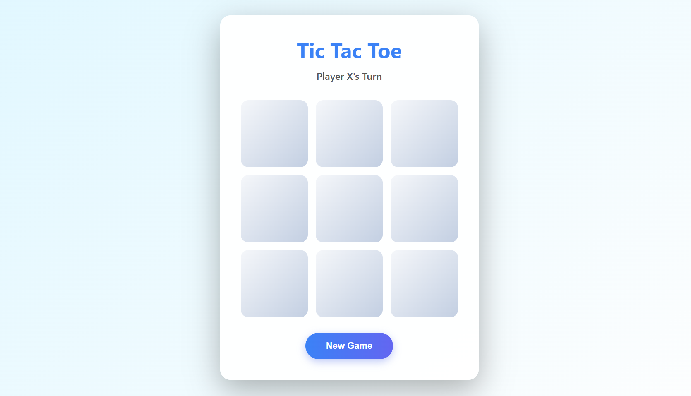

<h1 align="center">🎮 Tic Tac Toe</h1>

  <i>A sleek, minimal, and interactive Tic Tac Toe game built with pure HTML, CSS, and JavaScript.</i> 
  Designed with a clean UI, smooth gameplay, and a soft glassmorphism effect for a modern look.

  
  
  
  

---

## 🌐 Live Demo

🚀 The project is deployed and live!  
👉 [**Visit the Game**](https://tic-tac-toe-1-6.netlify.app/)  

---

## 🌟 Overview

An interactive **Tic Tac Toe Web Game** that brings the classic logic puzzle to life in a modern, responsive design.  
Play against another player on the same screen with instant feedback and win detection.

---

## 🎨 Preview

| 💻 Game UI |
|:-----------:|
|  |

---

## 🚀 Features

✅ **Two-Player Mode** – play locally with friends  
✅ **Dynamic Turn Indicator** – shows whose turn it is  
✅ **Instant Win & Draw Detection** – clean, no-delay logic  
✅ **Glassmorphism Design** – elegant modern interface  
✅ **Responsive Layout** – adapts to all screen sizes  
✅ **Restart Option** – quick “New Game” reset  

---

## 🛠️ Tech Stack

| Technology | Purpose |
|-------------|----------|
| **HTML5** | Game structure and grid layout |
| **CSS3** | Styling, gradients, and glassmorphism UI |
| **JavaScript (ES6)** | Game logic, turns, and event handling |

---

## ⚙️ How It Works

1. The 3×3 grid is created using HTML and styled with CSS for a soft, neumorphic look.  
2. JavaScript tracks player turns and updates the board in real-time.  
3. After every move, the script checks for winning combinations or a draw.  
4. Once the game ends, the winner (or draw) is displayed.  
5. The **New Game** button resets the board instantly.  

---

Testing NEXOR pull request integration.
